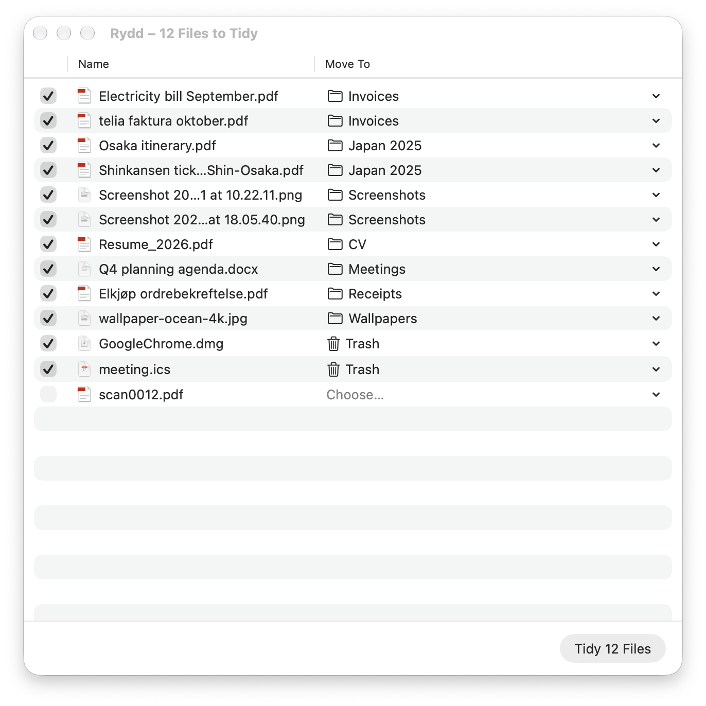

<p align="center"></p>

# Rydd

A small macOS menu bar app that keeps the folders you choose tidy. It learns from the folders you already have, suggests where each new file belongs, and moves only what you confirm. *Rydd* is Norwegian for "tidy up!".

- Choose the folders to tidy, such as Downloads and Desktop; Rydd reads nothing before you do
- Suggestions come from the folders you already have: rules for screenshots, installers and duplicates, matching against similar file names, and optionally Apple's on-device model
- Review every suggestion in one window, change where a file goes, and tidy with one click; every tidy can be undone
- Moves never overwrite a file, and "delete" always means the macOS Trash
- English and Simplified Chinese, following the system language
- No network access, no accounts, no analytics; file contents are read only if you turn that on, and never leave your Mac ([privacy policy](PRIVACY.md))



**Download:** Rydd 1.0 is free. A signed download will be on [Releases](https://github.com/tangfy97/Rydd/releases) and [tang-spark.no/rydd](https://tang-spark.no/rydd.html); until then you can build it from source. It needs macOS 26 Tahoe or later, and Apple Intelligence for the optional on-device sorting.

## Build

Requires Xcode 26 or later.

```sh
Scripts/build_app.sh          # build/Rydd.app, ad-hoc signed to run locally
open build/Rydd.app
```

The project is a Swift package with three targets: `RyddCore` (scanning, rules, matching, the on-device model, moving and undo), `RyddApp` (the menu bar app) and `rydd` (a command-line preview and evaluation tool).

| Script | What it does |
|---|---|
| `Scripts/build_app.sh` | Builds `build/Rydd.app` with its icon and localizations |
| `Scripts/make_icons.swift` | Renders `Design/AppIcon.svg` into `Design/AppIcon.icns` |
| `Fixtures/make_fixture.py` | Builds test folders with expected answers for `rydd --expect` |

How the engine works, the evaluation results and the development flags: [docs/DEVELOPMENT.md](docs/DEVELOPMENT.md). The user journey: [docs/user-journey.md](docs/user-journey.md).

## License

Copyright © 2026 TangSpark. Released under the [Apache License 2.0](LICENSE). Contributions: [CONTRIBUTING.md](CONTRIBUTING.md). Security: [SECURITY.md](SECURITY.md).
