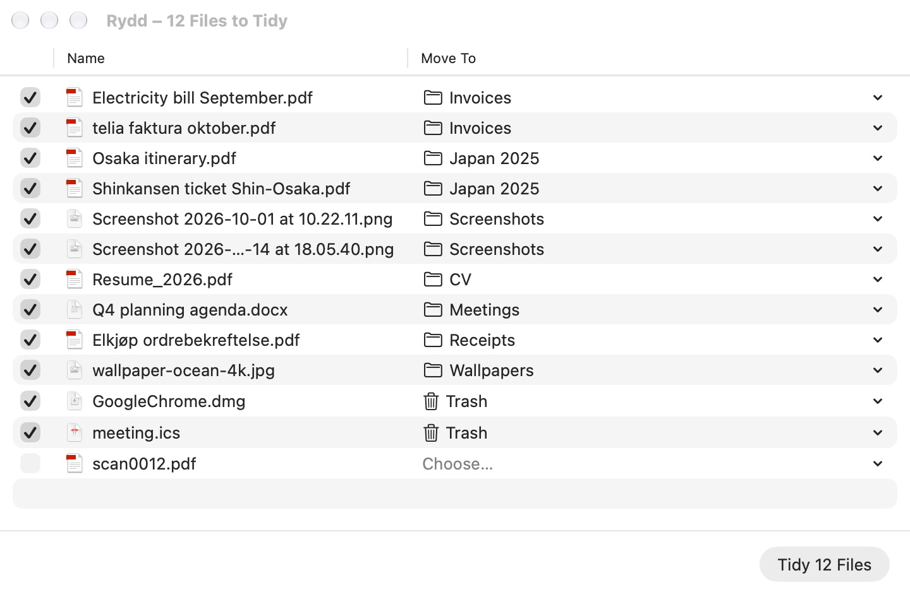

<p align="center"></p>

# Rydd

A small macOS menu bar app that keeps the folders you choose tidy. It learns from the folders you already have, suggests where each new file belongs, and moves only what you confirm. *Rydd* is Norwegian for "tidy up!".

- Choose the folders to tidy, such as Downloads and Desktop; Rydd reads nothing before you do
- Suggestions come from the folders you already have: rules for screenshots, installers and duplicates, matching against similar file names, and optionally Apple's on-device model
- Review every suggestion in one window, change where a file goes, and tidy with one click; every tidy can be undone
- Moves never overwrite a file, and "delete" always means the macOS Trash
- English, English (UK), Simplified Chinese and Traditional Chinese, following the system language
- Runs in the App Sandbox with no network access; no accounts, no analytics; file contents are read only if you turn that on, and never leave your Mac ([privacy policy](PRIVACY.md))



**Download:** Rydd 1.0 is free. Get the signed, notarized disk image from [Releases](https://github.com/tangfy97/Rydd/releases/latest) or [tang-spark.no/rydd](https://tang-spark.no/rydd.html); it is coming to the Mac App Store. It needs macOS 26 Tahoe or later, and Apple Intelligence for the optional on-device sorting.

## Build

Requires Xcode 26 and [XcodeGen](https://github.com/yonaskolb/XcodeGen) (`brew install xcodegen`).

```sh
scripts/build.sh          # sandboxed build in build/Rydd.app, signed to run locally
scripts/preflight.sh      # builds both release configurations and checks them before shipping
scripts/dev-app.sh        # unsandboxed development build from the Swift package, with test flags
```

`project.yml` is the source of truth for the Xcode project; edit it rather than the `.xcodeproj`, then run `xcodegen generate`. The `Release` configuration is the website build and `AppStore` the Mac App Store build; both run in the App Sandbox with no network entitlement. The Swift package builds the same code as `RyddCore` (scanning, rules, matching, the on-device model, moving and undo), the app, and `rydd`, a command-line preview and evaluation tool.

| Script | What it does |
|---|---|
| `scripts/release.sh` | Website build: Developer ID, notarized, as a DMG and zip in `build/release` |
| `scripts/appstore.sh` | App Store build: signed installer package, and `upload` sends it to App Store Connect |
| `scripts/publish-website.sh` | Copies the pages (and a notarized disk image) into the tang-spark.no site |
| `scripts/icon.swift` | Renders `Design/AppIcon.svg` into the asset catalog |
| `scripts/storeshot.swift` | App Store screenshot composition |
| `Fixtures/make_fixture.py` | Test folders with expected answers for `rydd --expect` |

Releasing, App Store Connect values and listing copy: [docs/APP_STORE.md](docs/APP_STORE.md). The website pages: [docs/WEBSITE.md](docs/WEBSITE.md). How the engine works and how it was evaluated: [docs/DEVELOPMENT.md](docs/DEVELOPMENT.md).

## License

Copyright © 2026 TangSpark. Released under the [Apache License 2.0](LICENSE). Contributions: [CONTRIBUTING.md](CONTRIBUTING.md). Security: [SECURITY.md](SECURITY.md).
